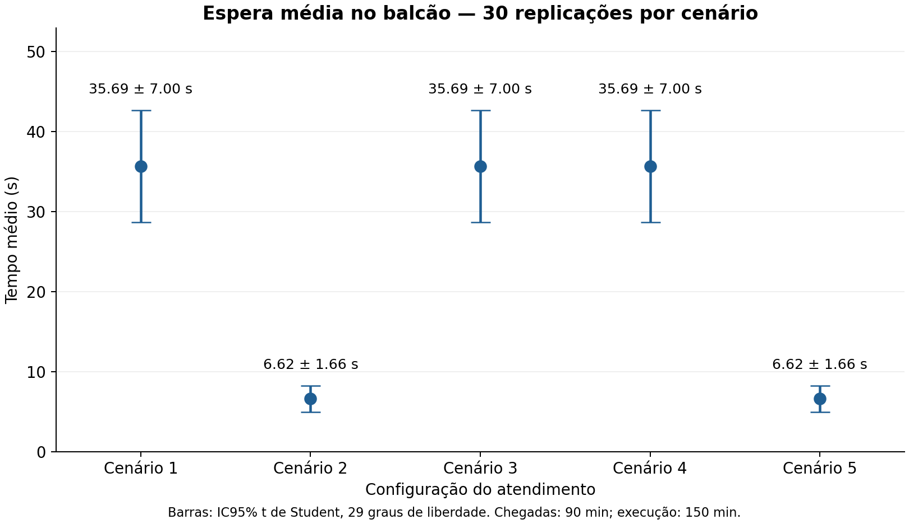

# Trabalho do Grau B — Simulação e Modelagem de Sistemas

**Simulação e análise do atendimento do Subway da Unisinos.** Disciplina: Simulação e Modelagem de Sistemas, UNISINOS. Professor: Alex Roehrs.

**Integrantes:** Ana Beatriz Stahl; Emanuele Schlemmer Thomazzoni; Gabriela Bley Rodrigues; Luisa Becker dos Santos.

Repositório oficial: [luisasbecker/tgb_simulacao_modelagem_de_sistemas](https://github.com/luisasbecker/tgb_simulacao_modelagem_de_sistemas).

## Status da versão Pessoa 1 + Pessoa 2

Os cinco modelos finais foram **executados no JaamSim 2026-08**, com 30 replicações cada (150 replicações analisadas). Há resultados reais, logs individuais, conservação auditada e IC95% recalculados. O motor não foi substituído por uma simulação Python: Python executa o JAR, verifica os registros e calcula estatísticas.

Esta entrega está na branch local `codex/pessoa2-validacao`. A conexão GitHub disponibilizada informa leitura e `push=false`; portanto estes arquivos ainda não foram publicados no repositório remoto. O workflow e o devcontainer estão preparados, mas não foram executados dentro do GitHub Actions/Codespaces. A execução headless em ambiente online desta sessão foi realizada.

| Verificação | Situação |
|---|---|
| Comparação GA / Pessoa 1 / tentativa Pessoa 2 | concluída; fontes e diffs preservados |
| Validação estática | cinco cenários aprovados; contrato preserva parâmetros da Pessoa 1 |
| Parser e motor JaamSim | execução curta, limites 5/6 e 5400 s, cinco cenários e 30 replicações aprovados |
| Análise estatística | dados novos, 30 observações por cenário, IC t95%, P90, comparações |
| Conservação e esvaziamento | zero remanescentes nas 150 replicações; balanço também conferido nos registros de estado |
| Interface gráfica nativa e vídeo | objetos aceitos em headless; revisão visual e gravação MP4 pendentes |
| Pessoa 3 | concluída no modelo: atributo QuantidadeLanches, duplicação dos lanches (Duplicate) e reunião por pedido antes do pagamento (Combine com MatchRequired), diagrama conceitual e animação atualizados. Conservação verificada em execução headless. Falta a revisão visual/vídeo |
| Pessoa 4 | etapa futura de experimentação final, incluindo gráficos da fila em degraus e do lead time com IC95%. Os resultados atuais validam a integração das Pessoas 1 e 2 |
| Relatório GB | PDF original preservado; roteiro de atualização pronto, sem editar o PDF nesta etapa |

## Sistema, objetivo e evolução GA → GB

Clientes chegam ao Subway, esperam por montagem, podem passar pela tostadeira e pagam no caixa. O estudo mede espera, ocupação, desistências e tempo total para comparar configurações de atendimento. Os dados são premissas sintéticas de projeto; os resultados são execuções reais desse modelo, não medições do estabelecimento.

O GA tinha três cenários, 90 minutos de execução e 10 replicações. A Pessoa 1 acrescentou C4/C5, definiu 2,5 horas e 30 replicações. A Pessoa 2 integrou tipos de pedido, montagem condicionada, desistência e contagem, corrigiu o corte das chegadas e reexecutou a experimentação. As bases estão preservadas em `docs/baselines/`.

## Cinco cenários preservados

| Cenário | Balcões em paralelo | Tostadeira | Caixas | P(tostar) | P(direto) |
|---|---:|---:|---:|---:|---:|
| 1 | 2 | 1 | 1 | 55% | 45% |
| 2 | 3 | 1 | 1 | 55% | 45% |
| 3 | 2 | 1 | 1 | 75% | 25% |
| 4 | 2 | 1 | 2 | 55% | 45% |
| 5 | 3 | 1 | 2 | 55% | 45% |

Fila única do balcão; fila única compartilhada entre os caixas de C4/C5. Chegadas somente em **0 ≤ t < 5400 s**, execução até **9000 s**, início vazio e sem aquecimento. A primeira chegada em t=0 é preservada do GA/Pessoa 1; as seguintes têm intervalos EXPO(90 s).

### Contribuição da Pessoa 1

Mantidos números de servidores, filas, FIFO, probabilidades de tostagem, tostagem TRIA(20,30,45 s), pagamento TRIA(18,38,95 s), streams originais, janela total, replicações, liberação do balcão antes de tostar e layout original. O corte de 90 minutos foi corrigido: MaxNumber=999 não representava um horário.

### Contribuição da Pessoa 2

| TipoPedido | Probabilidade | Montagem triangular: mínimo / moda / máximo |
|---|---:|---|
| 1 — simples | 40% | 45 / 70 / 110 s |
| 2 — tradicional | 45% | 75 / 110 / 160 s |
| 3 — complexo | 15% | 120 / 170 / 240 s |

O tipo é sorteado uma vez por cliente, inclusive desistentes; determina TempoMontagem, usado pelos balcões. Na chegada, `FilaBalcao.QueueLength > 5` leva à saída de desistência; clientes em serviço não entram nessa contagem. Quem encontra cinco aguardando pode entrar, deixando seis na fila. TotalDesistencias usa o contador nativo dessa saída. Lead time é medido desde HoraChegada até o pagamento concluído e exclui desistentes.

A implementação não cria sanduíches independentes. O [contrato com a Pessoa 3](docs/MODELO_CONCEITUAL.md#contrato-para-a-pessoa-3) exige herança do TipoPedido e contagem final por cliente. Após essa etapa, os resultados deverão ser recalculados novamente.

## Modelos finais e estrutura

Os arquivos executáveis finais são **models/cenario1.cfg** a **models/cenario5.cfg**. Os CFG em docs/baselines são históricos, e os de results/validation incluem testes que alteram demanda/duração; não são cenários finais.

| Caminho | Conteúdo |
|---|---|
| models/ | cinco CFG finais independentes |
| scripts/ | download verificado, execução real, auditoria, análise, gráficos e geração documentada dos CFG |
| tests/ | testes determinísticos no motor e regressão do leitor DAT/log |
| results/runs/ | execução validada: 150 replicações; CFG executados, DAT, REP e logs |
| results/replicacoes.csv | uma linha por cenário/replicação, inclusive desistências e P90 |
| results/resumo_ic95.csv | média, DP, n, limites e semi-amplitude para todos os indicadores |
| results/comparacoes_ic95.csv | regra de sobreposição e IC pareado complementar |
| results/conservacao.csv | balanço, remanescentes e auditoria por replicação |
| results/figures/ | gráficos PNG/SVG com IC e série em degraus |
| results/validation/ | testes, falhas recebidas e evidências da correção |
| docs/ | comparação, modelo conceitual, validação, alterações do relatório e fontes |
| .github/workflows/jaamsim.yml | workflow preparado para executar e guardar evidências |
| .devcontainer/ e Dockerfile | ambiente Linux/Java/Python para Codespaces |
| tools/ | JAR oficial do JaamSim 2026-08 versionado com sua licença e verificado por SHA-256 |

## Executar e reproduzir

Pré-requisitos: Java 17, Python 3.12, Bash e curl. Use o [JAR oficial 2026-08](https://github.com/jaamsim/jaamsim/releases/tag/v2026-08). SHA-256: `83e87bcde04b5dc8c06bac8dfb665e120fa6306aebe6ed6d49fb2ed1835223bf`.

Na raiz do projeto:

```bash
python3 -m venv .venv
source .venv/bin/activate
python3 -m pip install -r requirements.txt
bash scripts/download_jaamsim.sh
python3 scripts/validate_cfg.py
python3 -m unittest discover -s tests -p 'test_io.py'
python3 tests/test_runtime.py
bash scripts/run_all.sh --output results/reexecutions/minha_execucao/runs
python3 scripts/plot_results.py results/reexecutions/minha_execucao
```

`run_all.py` executa cinco processos JaamSim, um por cenário, cada um com 30 replicações. Confere DAT/REP/logs e chama a análise. Não substitui resultados existentes: escolha um caminho novo. Uma única linha de execução com cinco CFG não é usada como cinco experimentos.

Para somente reanalisar os resultados entregues:

```bash
python3 scripts/analyze_results.py results/runs
python3 scripts/plot_results.py results
```

Para uma prévia com uma replicação de cada cenário:

```bash
python3 scripts/run_all.py --replications 1 --output results/reexecutions/previa
```

Interface gráfica: `java -jar tools/JaamSim2026-08.jar`, File → Open → `models/cenarioN.cfg`, botão Play. A tela inclui título, relógio, quatro indicadores com unidades e gráfico rotulado. Para vídeo, use uma cópia do CFG com uma replicação; não altere os arquivos finais. A conferência visual e o vídeo nativo de até um minuto continuam pendentes.

Headless direto: `java -jar tools/JaamSim2026-08.jar models/cenario1.cfg -h`. Isso grava saídas ao lado do modelo; prefira os scripts para separar evidências. O runner adapta a pasta temporária para ambientes restritos e verifica erros mesmo quando o Java retorna código zero.

Codespaces: após publicar esta branch, abrir o repositório com o devcontainer e seguir os comandos acima. GitHub Actions: publicar `.github/workflows/jaamsim.yml` e usar **Actions → Validar modelos JaamSim → Run workflow**, ou o gatilho de push/PR. O job executa testes e 150 replicações, e exporta resultados como artifact. Não há execução remota do workflow comprovada nesta entrega.

## Resultados novos

| Indicador | C1 | C2 | C3 | C4 | C5 |
|---|---:|---:|---:|---:|---:|
| Espera balcão (s) | 35.69 ± 7.00 | 6.62 ± 1.66 | 35.69 ± 7.00 | 35.69 ± 7.00 | 6.62 ± 1.66 |
| Lead time (s) | 231.22 ± 8.85 | 213.42 ± 7.04 | 237.27 ± 8.48 | 213.82 ± 7.34 | 186.33 ± 2.70 |
| Atendidos/replicação | 59.77 ± 2.91 | 59.87 ± 2.94 | 59.77 ± 2.91 | 59.77 ± 2.91 | 59.87 ± 2.94 |
| Desistentes/replicação | 0.10 ± 0.15 | 0.00 ± 0.00 | 0.10 ± 0.15 | 0.10 ± 0.15 | 0.00 ± 0.00 |

Valores: média ± semi-amplitude IC95% t(29), 30 replicações. Gerados: 59.87 ± 2.94 clientes/replicação em todos os cenários. Remanescentes: zero em todas as 150 replicações. Desistências totais: C1=3, C2=0, C3=3, C4=3, C5=0. A ausência observada em C2/C5 não prova risco populacional zero.

Todos os números, DP, n, limites e unidades estão em [resumo completo](results/resumo.md) e [CSV](results/resumo_ic95.csv). Utilizações/comprimentos médios usam 9000 s; a vazão principal é atendidos/2,5 h. P90 é calculado dentro de cada replicação antes da consolidação.



C2 reduz a espera média no balcão em 81.46% em relação a C1, com intervalos não sobrepostos. No lead time, C5 tem a menor média (186.33 s) e IC separado dos demais. C2 e C4 têm ICs de lead time sobrepostos; não se escolhe entre eles apenas pela inspeção dos intervalos. C1 atende à meta de espera média abaixo de 300 s, com limite superior 42.69 s. A escolha de investimento depende de custos e metas adicionais, não modelados.

Não reutilizar os resultados anteriores. O relatório mistura janelas e contém afirmações incompatíveis com as chegadas ativas até o final. O [roteiro de atualização do GB](docs/ATUALIZAR_RELATORIO_GB.md) identifica cada seção, as tabelas antigas e os valores substitutos.

## Próximos passos

1. Publicar/revisar a branch preparada; a main remota permanece intacta.
2. Integrar a Pessoa 3 respeitando TipoPedido por cliente e refazer a experimentação.
3. Aplicar o roteiro de atualização ao fonte editável do relatório.
4. Conferir a animação nativa, gravar MP4 de até um minuto e atualizar slides.
5. Manter a declaração do uso de IA exigida pelo enunciado e assegurar que o grupo explique as decisões.

Detalhes: [preservação](docs/PRESERVACAO.md), [alterações e erros corrigidos](docs/ALTERACOES.md), [modelo conceitual](docs/MODELO_CONCEITUAL.md), [validação](docs/VALIDACAO.md).
