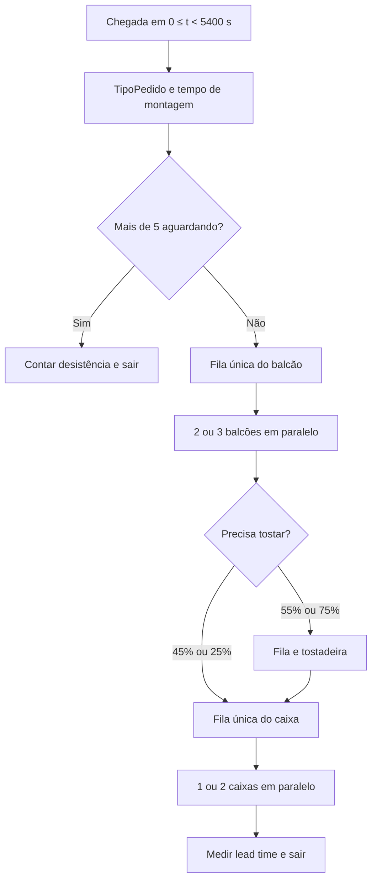

# Modelo conceitual e contrato de integração

## Entidade, fluxo e fronteira

A entidade é o cliente/pedido, com um lanche nesta etapa. A chegada é registrada antes de qualquer fila. Não há agrupamento nem duplicação de sanduíches implementado pela Pessoa 2.

O balcão é liberado antes da tostagem; não há bloqueio entre etapas. Os dois caixas dos cenários 4/5 retiram clientes da mesma FilaCaixa. A decisão condicional é imediata, sem abandono posterior de quem já entrou na fila. Clientes em serviço não são contados em QueueLength. A fila pode atingir 6: quando encontra 5 aguardando, o novo cliente ainda entra.

## Distribuições e justificativas

| Variável | Distribuição | Parâmetros | Stream |
|---|---|---|---:|
| Intervalo de chegada | Exponencial | média 90 s | 1 |
| TipoPedido | Discreta | 1:40%; 2:45%; 3:15% | 9 |
| Montagem simples | Triangular | mínimo 45 s; moda 70 s; máximo 110 s | 10 |
| Montagem tradicional | Triangular | mínimo 75 s; moda 110 s; máximo 160 s | 11 |
| Montagem complexa | Triangular | mínimo 120 s; moda 170 s; máximo 240 s | 12 |
| Tostagem | Triangular | mínimo 20 s; moda 30 s; máximo 45 s | 3 |
| Pagamento | Triangular | mínimo 18 s; moda 38 s; máximo 95 s | 4 |
| Rota de tostagem | Discreta | 55/45% ou 75/25% | 5 |

As distribuições originais são premissas sintéticas de projeto, documentadas na aba Fontes da planilha do GA; os parâmetros da aba Resumo não foram ajustados novamente nem usados para substituir a base. A exponencial representa intervalos independentes; a triangular representa uma duração limitada com mínimo, valor mais provável e máximo. Os três tipos e suas probabilidades são decisões de modelagem fornecidas para a Pessoa 2, não estimativas empíricas extraídas de clientes reais. A média teórica da mistura de montagem é 108,25 s, frente a 121,67 s na distribuição única anterior.

Preserva-se uma chegada em t=0 (`FirstArrivalTime=0`), seguida de intervalos EXPO(90 s). Portanto o número esperado antes de 5400 s é aproximadamente 61 (1 + 5400/90), e não se deve descrever a primeira chegada como exponencial. O sistema inicia vazio imediatamente antes dessa primeira chegada.

## Atributos e indicadores

TipoPedido é definido exatamente uma vez na chegada, inclusive para clientes que depois desistem. O ternário de SorteiaMontagem consulta somente a distribuição correspondente. TempoMontagem armazena uma duração única que todos os balcões usam em ServiceTime; não há novo sorteio pelo servidor. HoraChegada nunca é reiniciada. FilaNaChegada registra uma fotografia da fila antes da decisão.

TotalDesistencias é um CustomOutput numérico de Simulation que lê SaidaDesistencia.NumberAdded. Usar o contador nativo do destino evita um contador manual divergente e garante reinício por replicação. Lead time é `SimTime - HoraChegada`, coletado em EstatSistema depois do pagamento, somente na rota dos atendidos. Os logs verificam a decomposição em esperas e serviços.

ClientesAindaNoSistema é uma medida independente: soma das três filas e NumberInProgress de todos os balcões, da tostadeira e dos caixas. Não se usa apenas gerados menos saídas para afirmar conservação; o balanço é comparado com a ocupação medida. O intervalo pendente do gerador após o fechamento não é um cliente criado e não entra no estoque.

| Indicador | Unidade e medição | Meta ou papel |
|---|---|---|
| Espera média no balcão (principal) | segundos, entrada em FilaBalcao até início da montagem | média inferior a 300 s; comparar redução C2/C1 |
| TotalDesistencias | clientes, chegadas desviadas diretamente à saída própria | acompanhar perdas; menor é preferível, sem inventar meta numérica adicional |
| Lead time | segundos, criação do cliente até conclusão do pagamento | comparar serviço completo, somente atendidos |
| P90 do lead time | segundos, percentil empírico por replicação, interpolação linear | avaliar a cauda; resumir os 30 P90s |
| Vazão | clientes/h, atendidos ÷ 2,5 h | janela completa; exportação adicional divide por 1,5 h e é rotulada separadamente |

Utilizações e comprimentos médios são integrais no intervalo [0,9000] s. A diluição pela hora final ociosa é esperada. As esperas são médias dos clientes que passaram por cada fila. O esvaziamento observado permite relacionar a área de fila com a soma das esperas sem censura final.

## Sementes e comparação

RandomSeed identifica streams distintos. GlobalSubstreamSeed permanece no padrão do JaamSim: número da replicação, de 1 a 30. Entre cenários, a auditoria confirmou os mesmos instantes de chegada, tipos e tempos sorteados para cada cliente de mesma posição na replicação. Tostagem e pagamento consomem seus streams conforme a ordem dos serviços; não se presume pareamento perfeito desses serviços por identidade do cliente.

As 30 replicações, e não os clientes individuais, são a unidade para IC das médias. O principal é comum aos cinco cenários (Wq balcão); W é complementar. Usa-se t(0,975;29) × s/√30. ICs não sobrepostos indicam diferença segundo a disciplina; ICs sobrepostos não autorizam concluir diferença pela inspeção. O IC pareado da diferença é apresentado separadamente, sem ajuste de comparações múltiplas, como complemento exploratório.

## Contrato para a Pessoa 3

1. Manter o cliente como proprietário do pedido, do TipoPedido e da HoraChegada.
2. Cada item criado no futuro recebe o TipoPedido do cliente; não sortear complexidade independente para sanduíches.
3. Se houver tempos por item, cada item pode sortear sua duração na distribuição correspondente ao tipo herdado; não confundir igualdade de classificação com obrigação de durações idênticas.
4. Avaliar desistência uma vez, antes de criar itens; cliente desistente não gera lanches nem chega ao caixa.
5. Após a futura reunião dos itens, registrar pagamento/lead time e atendimento uma vez por cliente. Não contar itens como clientes no balanço.
6. Preservar identidade do cliente, tempo inicial e streams documentados; ampliar a auditoria para relacionar itens e pedidos.
7. Reexecutar as 150 replicações após essa integração. Estes resultados são válidos para Pessoa 1 + Pessoa 2, antes da Pessoa 3.

Os servidores em paralelo existentes são preservados. A adequação do requisito específico de lotes/duplicações à solução da Pessoa 3 continua a cargo dessa etapa.
